<div align="center">

  

  # 📄 Awesome PDF Viewer

  <p align="center">
    <strong>A curated directory of top-tier PDF Viewers, Web Rendering Engines, Lightweight Desktop Readers, Annotation Suites &amp; Cloud SaaS Platforms.</strong>
  </p>

  <p align="center">
    <a href="https://github.com/ishandutta2007/Awesome-Awesome-Awesome"></a><a href="https://discord.gg/jc4xtF58Ve"></a>
    <a href="https://github.com/ishandutta2007/Awesome-PDF-Viewer/stargazers"></a>
    <a href="https://github.com/ishandutta2007/Awesome-PDF-Viewer/network/members"></a>
    <a href="https://github.com/ishandutta2007/Awesome-PDF-Viewer/blob/main/LICENSE"></a>
    <a href="https://github.com/ishandutta2007/Awesome-PDF-Viewer/pulls"></a>
    <a href="https://github.com/ishandutta2007"></a>
  </p>

</div>

---

## 📖 Overview &amp; Ecosystem Landscape

In modern digital workplaces and software architectures, **PDF Viewers** form the critical bridge between portable document files and end-user interactions. From featherweight desktop binaries that render complex vector documents in sub-10 milliseconds to client-side HTML5 canvas parsers embedding interactive documents into web apps without external plugins, selecting the appropriate PDF rendering engine dictates application responsiveness, memory footprint, security sandboxing, and annotation precision.

This repository tracks the leading **commercial SaaS document platforms** alongside active **open-source PDF viewers, rendering engines, and developer SDKs** (such as SumatraPDF, PDF.js, Okular, MuPDF, Sioyek, and Stirling PDF). Whether you require a distraction-free keyboard-driven reader for dense academic papers, a headless rendering backend for document pipelines, or a zero-telemetry self-hosted document toolkit, this curated guide benchmarks the modern PDF viewing ecosystem.

---

## 📑 Table of Contents

- [🌐 Sector Overview &amp; Market Dynamics](#-sector-overview--market-dynamics)
- [☁️ SaaS &amp; Hosted PDF Viewer Platforms](#️-saas--hosted-pdf-viewer-platforms)
- [🔓 Open-Source GitHub Projects (Ranked by Stars)](#-open-source-github-projects-ranked-by-stars)
- [📊 Architectural &amp; Feature Comparison Matrix](#-architectural--feature-comparison-matrix)
- [🤝 How to Contribute](#-how-to-contribute)
- [📈 Star History](#-star-history)
- [💖 Support &amp; Sponsorship](#-support--sponsorship)
- [⚖️ Disclaimer](#️-disclaimer)

---

## 🌐 Sector Overview &amp; Market Dynamics

The global **PDF Software and Digital Document Processing market** was valued at approximately **$3.2 Billion in 2024** and is projected to expand to **$7.8–$10.8 Billion by 2030**, exhibiting a robust Compound Annual Growth Rate (**CAGR of ~8.5% to 12.1%**). This accelerating expansion is propelled by global paperless digital transformation mandates, distributed remote-work collaboration requirements, and the widespread migration toward client-side WebAssembly (Wasm) and HTML5 browser-native rendering engines.

Market concentration follows a two-tier paradigm:
1. **Enterprise Desktop Tier (Concentrated / Incumbent Dominance)**: Publicly traded legacy enterprise players—principally Adobe—continue to dominate the traditional office environment with Acrobat (~70%+ market penetration), leveraging proprietary PDF form workflows, established compliance standards, and bundle distribution.
2. **Web, Browser &amp; Developer Tier (Moderately Fragmented)**: The browser-native rendering, lightweight desktop, and specialized annotation segments are dynamic and moderately fragmented. Lightweight open-source engines (such as Mozilla's PDF.js and MuPDF) and agile freemium SaaS platforms (Smallpdf, Kami, Sejda, Lumin) have decentralized the PDF ecosystem, providing agile, privacy-centric, and cost-effective alternatives to heavyweight traditional desktop readers.

---

## ☁️ SaaS &amp; Hosted PDF Viewer Platforms

The table below outlines leading enterprise hosted and cloud-first SaaS PDF viewers, document annotators, and web editing platforms. Sorted strictly by **Company Scale (Valuation / Revenue) Descending**:

| Platform / Product | Company &amp; Scale (Valuation / Revenue) | Starting Tier Pricing | Free Tier / Free Trial Limits | Key Capabilities &amp; Target Use Case |
| :--- | :--- | :--- | :--- | :--- |
| **[Adobe Acrobat](https://www.adobe.com/acrobat.html)** | **Adobe Inc.** (NASDAQ: ADBE)<br>📊 Valuation: ~$150B–$200B Market Cap<br>💰 FY24 Revenue: $21.5B (FY25: $23.8B) | **$12.99 / month** (Acrobat Standard, annual contract billed monthly at $12.99/mo or $155.88/yr; Pro tier at $19.99/mo) | **Free-forever plan (Acrobat Reader &amp; Web)**: Unlimited viewing, printing, text/sticky note comments, form filling, simple signing, and 2 GB Adobe cloud storage; plus a **7-day free trial** of Acrobat Pro with full editing, format conversion, and OCR | The de facto commercial PDF viewer and editor with ubiquitous enterprise form handling, signature workflows, and cloud collaboration. Trade-off: heavy resource footprint and continuous background sync processes. |
| **[Foxit PDF](https://www.foxit.com/)** | **Foxit Software Inc.** (SSE: 688095)<br>📊 Valuation: ~$740M Market Cap<br>💰 Annual Revenue: ~$160M–$180M USD | **$10.83 / month** (billed annually at $129.99/year for Foxit PDF Editor; Editor+ tier at $159.99/yr) | **Free-forever plan (Foxit PDF Reader)**: Unlimited viewing, printing, basic commenting/marking, standard form filling, and 300 free AI assistant credits/month; plus a **14-day free trial** of Foxit PDF Editor+ (no credit card required) with desktop/cloud editing, OCR, and conversion tools | Lightweight Adobe Acrobat alternative offering fast rendering, form filling, and lower memory footprint. Best for Windows/desktop users seeking Acrobat compatibility without Adobe's resource overhead. |
| **[PDFescape](https://www.pdfescape.com/)** | **Claranova / Avanquest** (Euronext: CLA)<br>📊 Valuation: ~$120M Market Cap<br>💰 FY24 Revenue: €496M (~$540M Group) | **$2.99 / month** (Premium plan billed annually at $35.88/year, or $5.99/month billed monthly; Ultimate plan at $5.99/mo annual) | **Free-forever plan**: Web-based viewing, annotation, form filling, and form design capped at **10 MB per file**, **100 pages per file**, and up to **10 stored documents** (ad-supported); plus a **7-day free trial** of Premium desktop edition | Long-running web-based PDF viewer and form filler with minimal system requirements. Best for basic browser form completion and quick page deletion without account creation. |
| **[Kami](https://www.kamiapp.com/)** | **Kami (Notable PDF) / BV Investment**<br>📊 Valuation: ~$185M+ (NZD $300M+)<br>💰 ARR: ~$22M+ (40M+ Users) | **$12.42 / month** (billed annually at $149/year for Teacher / Pro plan) | **Free-forever Basic plan**: Unlimited viewing, 10+ core annotation tools (highlight, markup, text box, shapes), OCR text recognition, and Google Drive/OneDrive auto-sync; plus a **30-day free trial** of the full Teacher Plan (40+ tools, LMS integrations, audio/video comments) | Interactive digital classroom and PDF document annotator optimized for Chromebooks and educational LMS workflows. Best for interactive classroom instruction and markup grading. |
| **[Smallpdf](https://smallpdf.com/)** | **Smallpdf AG**<br>📊 Valuation: ~$100M+ (Private / Bootstrapped)<br>💰 ARR: ~$10M–$19M (50M+ MAU) | **$9.00 / month** (Pro Individual plan billed annually at $108/year, or $15/month billed monthly) | **Free-forever plan**: Web viewer and 21+ PDF tools capped at **2 document tasks per day**, 2 e-signatures per month, and standard file compression; plus a **7-day free trial** of Pro with unlimited tasks, batch processing, and OCR | Cloud-first browser PDF viewer and converter suite with simple drag-and-drop interface. Best for quick everyday document adjustments, compression, and signature requests. |
| **[Lumin PDF](https://www.luminpdf.com/)** | **Lumin (Nitrolabs)**<br>📊 Valuation: ~$25M–$40M (Private)<br>💰 ARR: ~$4.6M (100M+ Users) | **$9.00 / month** (Starter plan billed monthly, or $72/year billed annually at $6/month; Pro plan at $19/month) | **Free-forever plan**: Basic viewing, highlighting, annotation, and real-time collaboration capped at **3 completed/downloaded/shared documents per month**; plus a **7-day free trial** of Pro with inline text editing and page manipulation | Cloud document viewer deeply integrated with Google Drive and Google Classroom, supporting live collaborative markups. Best for student, teacher, and remote team document reviews. |
| **[Sejda PDF](https://www.sejda.com/)** | **Sejda**<br>📊 Valuation: ~$15M–$25M (Bootstrapped)<br>💰 ARR: ~$3M–$6M (Top 3.2K Web Rank) | **$5.00** (one-time 7-day Web Week Pass; or **$7.50 / month** for recurring Web Monthly, $63/year for Desktop + Web) | **Free-forever plan**: Up to **3 tasks per day/hour**, maximum file size of **50 MB or 200 pages**, OCR up to **10 pages**, and file merging up to 30 files / 50 pages; no credit card required | Online and desktop PDF viewer and editor with zero-install browser processing and flexible short-term passes. Best for occasional editing, signing, and page reordering without annual commitments. |

---

## 🔓 Open-Source GitHub Projects (Ranked by Stars)

Below are the most prominent, active open-source PDF viewers, rendering engines, and developer libraries—ordered strictly in **descending order by GitHub Stars**:

### 1. [Stirling PDF](https://github.com/Stirling-Tools/Stirling-PDF) [](https://github.com/Stirling-Tools/Stirling-PDF/stargazers)
- **License**: NOASSERTION (Open-Core) | **Primary Language**: TypeScript / Java
- **Architecture**: Self-Hosted Web Application &amp; Multi-Platform Desktop Suite
- **Overview**: The #1 PDF toolkit and application on GitHub with over 18 million downloads. Stirling PDF provides a self-hosted, browser-accessible suite with native desktop applications for Windows, macOS, and Linux. Delivers comprehensive viewing, merging, splitting, converting, OCR, electronic signatures, redaction, watermarking, and document comparison. Free for individuals and teams up to 5 members.

### 2. [PDF.js](https://github.com/mozilla/pdf.js) [](https://github.com/mozilla/pdf.js/stargazers)
- **License**: Apache-2.0 | **Primary Language**: JavaScript / HTML5
- **Architecture**: Web Standards-Based Client-Side PDF Parsing &amp; Rendering Engine
- **Overview**: Maintained by Mozilla, PDF.js is the universal standard for browser-native PDF viewing without third-party plugins. Powers Mozilla Firefox's built-in PDF viewer and serves as the core rendering foundation for hundreds of web applications, browser extensions, and React/Vue wrappers. Renders documents directly onto HTML5 Canvas or SVG layers.

### 3. [KOReader](https://github.com/koreader/koreader) [](https://github.com/koreader/koreader/stargazers)
- **License**: AGPL-3.0 | **Primary Language**: Lua / C
- **Architecture**: Lightweight Multi-Platform Document Reader for E-Ink &amp; Mobile
- **Overview**: An extremely fast, distraction-free document reader supporting PDF, DjVu, EPUB, FB2, and CBZ formats. Originally designed for E-Ink devices (Kindle, Kobo, Onyx), KOReader runs natively across Android, Linux, macOS, and Windows. Features intelligent multi-column reflow, complex margin cropping, dictionary lookups, and OCR text recognition.

### 4. [Koodo Reader](https://github.com/koodo-reader/koodo-reader) [](https://github.com/koodo-reader/koodo-reader/stargazers)
- **License**: AGPL-3.0 | **Primary Language**: JavaScript / TypeScript / Electron
- **Architecture**: Modern Cross-Platform Desktop &amp; Web Document Reader
- **Overview**: An all-in-one modern document reader supporting PDF, EPUB, MOBI, CBR, CBZ, and Markdown. Features cross-device cloud synchronization (via WebDAV, Dropbox, OneDrive, Google Drive), customizable reading layouts, dark mode, text-to-speech (TTS), translation, and comprehensive annotation management.

### 5. [SumatraPDF](https://github.com/sumatrapdfreader/sumatrapdf) [](https://github.com/sumatrapdfreader/sumatrapdf/stargazers)
- **License**: GPL-3.0 | **Primary Language**: C / C++
- **Architecture**: Ultra-Lightweight Native Windows Document Reader
- **Overview**: The undisputed lightweight champion for Windows. Weighing only ~10 MB, SumatraPDF opens documents instantly with sub-second startup times and minimal RAM consumption. Supports PDF, EPUB, MOBI, Comic Books (CBZ/CBR), DjVu, XPS, and CHM. Offers full portable mode executable from USB drives with zero registry pollution.

### 6. [BentoPDF](https://github.com/alam00000/bentopdf) [](https://github.com/alam00000/bentopdf/stargazers)
- **License**: AGPL-3.0 | **Primary Language**: JavaScript / Docker
- **Architecture**: Privacy-First Client-Side Web PDF Toolkit
- **Overview**: A self-hosted, containerized PDF workspace deployed via Docker where all document processing occurs strictly client-side inside the user's web browser. Files never leave your local machine or server network. Includes interactive form creation, document redaction, page merging/splitting, conversion, and metadata stripping.

### 7. [Xournal++](https://github.com/xournalpp/xournalpp) [](https://github.com/xournalpp/xournalpp/stargazers)
- **License**: GPL-2.0 | **Primary Language**: C++ / GTK
- **Architecture**: Stylus &amp; Handwritten Note-Taking Document Annotator
- **Overview**: Built for tablet and desktop users who need precise handwritten annotations, stylus input with pressure sensitivity, and shape recognition on top of PDF documents. Features audio recording synchronized with handwritten notes, LaTeX formula integration, and multi-format PDF/PNG exports across Windows, macOS, and Linux.

### 8. [React-PDF](https://github.com/wojtekmaj/react-pdf) [](https://github.com/wojtekmaj/react-pdf/stargazers)
- **License**: MIT | **Primary Language**: TypeScript / React
- **Architecture**: React Component Library for Client-Side PDF Rendering
- **Overview**: Enables React applications to display PDFs as seamlessly as standard images. Built on top of Mozilla's PDF.js, React-PDF handles page rendering, text selection layers, annotation layers, and responsive scaling without needing server-side rendering or heavy iframe embeds.

### 9. [Sioyek](https://github.com/ahrm/sioyek) [](https://github.com/ahrm/sioyek/stargazers)
- **License**: GPL-3.0 | **Primary Language**: C / C++
- **Architecture**: Research &amp; Academic Paper Reading Specialist
- **Overview**: A specialized PDF viewer engineered specifically for reading dense textbooks, technical literature, and scientific papers. Sioyek allows smart jumping between figures, formulas, and references even when documents lack embedded hyperlinks. Features deep Synctex bidirectional LaTeX integration and programmable vim-like keybindings.

### 10. [Foliate](https://github.com/johnfactotum/foliate) [](https://github.com/johnfactotum/foliate/stargazers)
- **License**: GPL-3.0 | **Primary Language**: JavaScript / GJS (GTK4)
- **Architecture**: Modern GNOME/Linux Desktop Document &amp; E-Book Reader
- **Overview**: A modern, sleek document reader built for the Linux desktop with GTK4 and Libadwaita. Supports PDF, EPUB, MOBI, and Comic Book archives. Offers customizable typography, reading progress tracking, inline annotations, dictionary lookups, and text-to-speech integration.

### 11. [Zathura](https://github.com/pwmt/zathura) [](https://github.com/pwmt/zathura/stargazers)
- **License**: Zlib | **Primary Language**: C / GTK
- **Architecture**: Minimalist Modal Keyboard-Centric Document Viewer
- **Overview**: A highly customizable and functional document viewer with a minimalist, space-saving interface. Driven by vi-like modal keybindings, Zathura uses a modular plugin architecture to render PDF (via Poppler or MuPDF), PostScript, and DjVu files. Preferred by developers, sysadmins, and terminal enthusiasts.

### 12. [MuPDF](https://github.com/ArtifexSoftware/mupdf) [](https://github.com/ArtifexSoftware/mupdf/stargazers)
- **License**: AGPL-3.0 | **Primary Language**: C
- **Architecture**: High-Fidelity C Rendering Engine &amp; Spartan Reader
- **Overview**: Created by Artifex, MuPDF is an ultra-fast software framework for viewing, rendering, and converting PDF, XPS, and eBook documents. Acts as the core rendering backend behind SumatraPDF and numerous mobile readers. Includes the versatile `mutool` command-line utility for automated document extraction, repairs, and rasterization.

### 13. [Okular](https://github.com/KDE/okular) [](https://github.com/KDE/okular/stargazers)
- **License**: GPL-2.0+ | **Primary Language**: C++ / Qt
- **Architecture**: Universal Cross-Platform Multi-Format Document Viewer
- **Overview**: The reference universal document viewer from the KDE community. Supports PDF, PostScript, DjVu, CHM, XPS, EPUB, TIFF, and Markdown. Renowned for annotation tools (highlights, text notes, stamps, typewriter forms) that can be saved either embedded directly or stored separately to preserve the original file. Cross-platform on Linux, Windows, and macOS.

### 14. [ngx-extended-pdf-viewer](https://github.com/stephanrauh/ngx-extended-pdf-viewer) [](https://github.com/stephanrauh/ngx-extended-pdf-viewer/stargazers)
- **License**: Apache-2.0 | **Primary Language**: TypeScript / Angular
- **Architecture**: Turnkey Angular Component for Enterprise PDF Viewing
- **Overview**: A comprehensive, production-ready PDF viewer component tailored for Angular 18, 19, and beyond. Packages the full Mozilla PDF.js UI into an easily customizable Angular directive with print, form filling, signature, search, and responsive toolbar controls out of the box.

### 15. [Evince](https://github.com/GNOME/evince) [](https://github.com/GNOME/evince/stargazers)
- **License**: GPL-2.0+ | **Primary Language**: C / GTK
- **Architecture**: GNOME Desktop Reference Document Viewer
- **Overview**: The standard default document viewer for the GNOME desktop environment. Supports PDF, PostScript, DjVu, TIFF, and DVI. Features clean system integration, table-of-contents navigation, text selection, basic form filling, and PDF presentation mode.

---

## 📊 Architectural &amp; Feature Comparison Matrix

| Project | Primary Engine | Supported Platforms | Footprint / Memory | Annotations &amp; Forms | Browser / Web Native | Primary Sweet Spot |
| :--- | :--- | :--- | :--- | :--- | :--- | :--- |
| **Stirling PDF** | PDFBox / LibreOffice | Docker / Web / Win / Mac / Linux | ~200MB Docker | ✅ Comprehensive | ✅ Native Web App | Self-hosted organizational PDF toolkit &amp; Acrobat alternative |
| **PDF.js** | HTML5 Canvas / JS | Web / Cross-Platform | ~5MB Library | ⚠️ Annotations (Basic) | ✅ 100% Client-Side | Embedding PDF viewing inside web apps &amp; browsers |
| **KOReader** | MuPDF / FreeType | Android / E-Ink / Win / Mac / Linux | ~30MB | ⚠️ Highlights &amp; Notes | ❌ Native Only | E-Ink, mobile, and distraction-free document reading |
| **Koodo Reader** | Web Engine / PDF.js | Win / Mac / Linux / Web | ~80MB | ✅ Annotations &amp; Sync | ✅ Web &amp; Desktop | Multi-format eBook &amp; PDF library manager with cloud sync |
| **SumatraPDF** | MuPDF | Windows Only | ~10MB (Portable) | ⚠️ Basic Highlighting | ❌ Native Only | Instantaneous Windows reading with zero system bloat |
| **BentoPDF** | WebAssembly / JS | Docker / Web | ~50MB Docker | ✅ Forms &amp; Redaction | ✅ 100% Client-Side | Privacy-critical self-hosted tools with zero server file exposure |
| **Xournal++** | Poppler | Win / Mac / Linux | ~60MB | ✅ Stylus &amp; Handwritten | ❌ Native Only | Tablet stylus handwritten notes and PDF form annotation |
| **React-PDF** | PDF.js | Web (React Framework) | ~2MB Bundle | ⚠️ Via PDF.js Layers | ✅ React Native/Web | React frontends needing modular inline document rendering |
| **Sioyek** | MuPDF | Win / Mac / Linux | ~25MB | ✅ Academic / Portals | ❌ Native Only | Reading dense scientific papers, math, and LaTeX documents |
| **Foliate** | PDF.js / Epub.js | Linux (GTK4 / Libadwaita) | ~35MB | ✅ Notes &amp; Highlights | ❌ Desktop Native | Modern GNOME-native book and document reader |
| **Zathura** | Poppler / MuPDF | Linux / BSD / macOS | ~10MB | ⚠️ Plugin Dependent | ❌ CLI / Native | Keyboard-first minimalist reading with vi keybindings |
| **MuPDF** | MuPDF C Core | Win / Linux / Android / iOS | ~5MB Core | ❌ Deliberately Spartan | ⚠️ Via Wasm / Ports | Ultra-fast rendering engine &amp; CLI document scripting |
| **Okular** | Poppler / Qt | Linux / Win / macOS | ~50MB | ✅ Surpasses Adobe | ❌ Native Desktop | Cross-platform multi-format reader with advanced annotations |
| **ngx-extended-pdf-viewer** | PDF.js | Web (Angular Framework) | ~4MB Bundle | ✅ Complete Forms/UI | ✅ Angular Component | Enterprise Angular web apps requiring turnkey PDF viewer UI |
| **Evince** | Poppler | Linux (GNOME) | ~20MB | ⚠️ Basic Forms/Notes | ❌ GNOME Native | Standard GNOME desktop document reading and printing |

---

## 🤝 How to Contribute

Contributions, project suggestions, and documentation enhancements are highly encouraged!

1. **Fork the repository** to your own GitHub account.
2. **Create a descriptive feature branch**:
   ```bash
   git checkout -b feat/add-pdf-tool
   ```
3. **Commit your modifications** ensuring clear, factual descriptions, links to official documentation, and consistent Markdown table formatting.
4. **Push the branch** and **open a Pull Request** with an informative summary of your changes.

Star the repo if you find it useful!

---

## 📈 Star History

[](https://star-history.dera.page/#ishandutta2007/Awesome-PDF-Viewer&type=date&legend=top-left)

---

## 💖 Support &amp; Sponsorship

If you find this curated ecosystem directory valuable for your document workflows, application development, or open-source research, please consider supporting the project:

- ⭐ **Star this repository** on GitHub to amplify its visibility!
- 🍴 **Fork the repo** to save your personal reference copy.
- 📢 **Share with fellow developers**, researchers, and document architects.
- ☕ **Support continuous maintenance &amp; research** by sponsoring via the link below:

<p align="center">
  <a href="https://github.com/sponsors/ishandutta2007">
    
  </a>
</p>

---

## ⚖️ Disclaimer

- This repository is a **community-curated index** created solely for informational, architectural, and educational purposes. Mention of specific vendors, open-source projects, or commercial SaaS products does not constitute an official endorsement.
- Rendering fidelity varies across core engines (Poppler, MuPDF, PDFium, PDF.js): **PDF.js** operates client-side in browsers, but CMYK color swatches and appearance streams for interactive form fields can diverge slightly from native C/C++ rendering engines.
- **Resource Footprints**: Commercial suites like **Adobe Acrobat** include background cloud synchronization and collaboration services that consume considerable system memory, whereas native readers like **SumatraPDF** and **MuPDF** operate with near-zero baseline overhead.
- Always verify licensing requirements when embedding open-source engines into commercial software—especially AGPL-3.0 libraries (such as MuPDF or Stirling PDF) or commercial licensing options.

---

<p align="center">
  <strong>Crafted with ❤️ for software developers, document architects, researchers, and users seeking fast, private PDF viewing.</strong>
</p>
